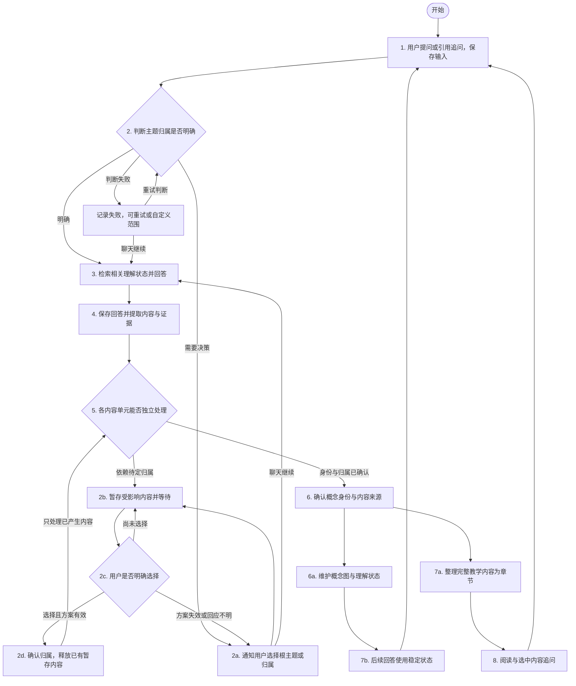
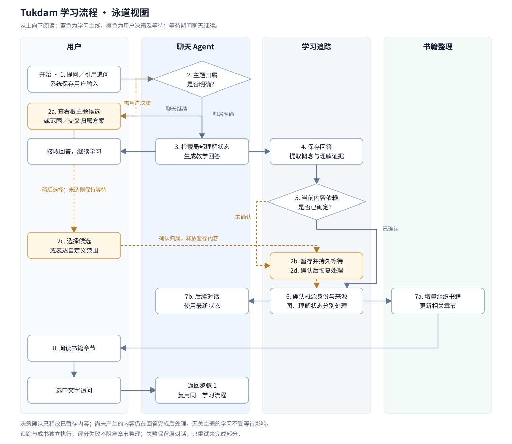

# Tukdam 产品需求文档 PRD

| 项目 | 内容 |
| --- | --- |
| 文档版本 | 0.8 |
| 状态 | 核心流程已定义；模型、参数及发布指标待验证 |
| 更新日期 | 2026年10月13日 |
| 产品决策与评审 | 用户 |
| 设计、开发与验收负责人 | 待指定 |
| 目标发布日期 | 待定 |
| 产品范围 | 聊天学习、根主题决策、概念图、个人理解状态、教程与引用追问 |
| 实现状态 | 本文定义目标需求；当前仓库为固定数据前端原型 |

结构依据：[Atlassian 官方产品需求模板](https://www.atlassian.com/software/confluence/templates/product-requirements/)。保留目标、指标、假设、用户故事、优先级、交互和开放问题，并补充本产品所需的业务对象、状态规则与验收追踪。

## 0 项目与会话的最新约定

- 侧栏以项目组织会话；新会话允许不绑定项目，未绑定会话单独显示。
- 用户先与 Agent 对话，初始交互后可由 Agent 提议项目名称和学习范围。用户明确确认创建新项目或归入已有项目后，会话才移动到项目下；暂不处理保持独立会话，聊天继续。
- 每个项目对应一份持续更新的教程，并承载该学习范围内的概念图。项目内多个会话的完整讲解合入同一教程，以章节组织，不按每次聊天另建教程。
- 用户在已有项目内主动新建会话时，可以直接绑定该项目。跨领域概念和理解证据仍可共享，项目归属不改变理解状态。
- 教程在主对话旁的辅助窗格阅读，引用默认建立独立会话，再按实际问题确认项目归属。
- 下文“根主题”指项目的学习范围，不再作为侧栏上需要预先选择的独立组织入口。

## 1 产品背景与目标

### 1.1 用户与问题

目标用户通过与 LLM 对话学习知识，希望系统在跨轮次、跨聊天学习时记得自己理解到哪里，并将分散的解释组织成可复习的内容。

产品解决三个问题：后续解释缺少个人理解上下文；对话中的知识及关联难以持续积累；聊天记录不便于系统阅读与复习。

### 1.2 产品目标

以自然聊天为主线，在用户确认的根主题范围内持续构建概念图、根据理解证据更新个人状态，并将对话组织成教程。用户阅读教程后发起引用追问，继续进入同一学习流程。

### 1.3 成功判据

- 用户无需预建地图，即可提问并选择学习范围。
- 新一轮及新聊天中的解释能利用已有的局部相关理解状态。
- 用户可以追溯状态变化的证据，模型讲过、用户读过不自动等于掌握。
- 已确认归属的学习内容能形成可阅读章节，并支持引用追问。
- 等待决策、后台失败和重启不导致聊天丢失、重复计分或重复归档。

以上为验收目标，不代表已经达到。性能与教学效果指标见第 10 节 D-08。

### 1.4 成功指标

以下指标口径作为首版评估要求；模型质量与时效目标值在原型实测后设定，不作为已有结果。业务指标与功能验收分别使用，不能把模型推断的熟悉程度当作学习效果指标。

| 目标 | 指标口径 | 目标值 |
| --- | --- | --- |
| 个性化解释有效 | 对相同问题设置不同已知状态，人工评审解释起点与误区处理是否适当；适当案例数／评审案例数 | 实测后设定 D-08 |
| 主题归属可靠 | 对人工标注问题集评审自动归属与请求澄清是否适当；正确处理数／评审问题数 | 实测后设定 D-08 |
| 笔记持续产出 | 已满足归档条件的内容，在约定时限内完成归档的比例；时限起点为条件满足时 | 生成条件已定 D-03，时限与比例实测后设定 D-08 |
| 阅读可以回到学习 | 引用追问中，成功回答且完成相关追踪与归档的比例；仍等待用户决策的案例单独统计 | 实测后设定 D-08 |
| 处理可靠 | 重启、重复决策和失败重试用例中，对话丢失、重复计分、重复正文的次数 | 验收用例中为 0 |

### 1.5 假设与验证

| 假设 | 验证方法 | 不成立时的调整 |
| --- | --- | --- |
| 用户愿意选择并维护学习范围 | 观察首问选择、暂不处理与自定义范围的操作 | 调整候选和通知方式，保留用户决策权 |
| LLM 能识别足够稳定的概念及归属 | 使用同义、同名、父级和交叉主题案例评审 | 降低自动归属范围，增加澄清与纠正 |
| 自然对话包含可用的理解证据 | 人工对照用户表达与系统证据判断 | 提高未知比例，不强行赋分；可选验证能力另行评审 |
| 主要保留原回答可形成可读教程 | 评审多轮学习后的章节完整性、重复与适用条件 | 调整组织规则，保留来源，不靠压缩掩盖问题 |

## 2 范围与需求状态

### 2.1 首版范围

| 范围 | 首版要求 |
| --- | --- |
| 聊天学习 | 自由提问、持续对话、使用个人理解上下文 |
| 根主题 | LLM 推理候选、用户确认范围、已有范围复用、范围与交叉归属决策 |
| 决策处理 | 后台通知、持久等待、暂存、用户确认后恢复处理 |
| 概念图 | 按主题生长、概念复用、跨主题关联、个人状态染色 |
| 理解追踪 | 每轮评估证据，可上调、下调或不变，保留来源 |
| 教程 | 以原解释为主体组织章节、持续更新、来源追溯 |
| 阅读复习 | 阅读章节、引用追问、回到同一学习流程 |
| 恢复能力 | 失败重试、重启恢复、重复处理保护 |

### 2.2 首版不要求

复杂知识追踪、个体化遗忘模型的正式上线、自动复习排期、完整领域地图预生成、外部资料导入、多人协作。概率追踪与记忆模型的研究、基线实现和评估属于首版工作；缺少有效模型时允许降级为证据记录与待估计状态，不展示未经验证的精确可用性。

### 2.3 状态说明

- **已确认**：用户已明确提出，或前序需求中已采用且本次保留的规则。
- **待确认**：为使需求可执行而提出的方案，尚不能作为最终开发口径。
- **已决策**：根据用户授权，结合既定方向直接确定的产品规则。
- **实现待定**：业务结果已确定，具体提示词、模型或技术方案仍需设计与实测。

用户已授权按既定方向推导并确定其余可决策事项。第 10 节分别记录用户确认、授权推导的决策和仍需讨论的事项；模型行为通过实际案例和提示词持续校准。

## 3 核心业务对象与规则

| 对象 | 业务含义 | 归属与约束 |
| --- | --- | --- |
| 项目与根主题 | 项目是会话和教程的组织容器；根主题描述该项目的学习范围 | 不必是知识体系最上层；不同项目可有范围重叠 |
| 概念 | 一个有确定含义和语境的知识单元 | 可关联多个主题；同名不一定同概念，同义不重复建节点 |
| 概念关系 | 包含、前置、关联等有明确含义的联系 | 相关不自动等于包含；图不限制为树 |
| 个人理解状态 | 历史证据支持的概念理解估计及不确定性 | 未知独立于零分；多主题共享状态和证据 |
| 当前可用性 | 当前能否回忆或应用某个具体目标的估计 | 与历史理解状态区分；无可校准模型时显示待估计 |
| 理解证据 | 支持状态判断的用户表达及上下文 | 对应原始对话、概念、发生时间与处理记录 |
| 对话内容 | 用户问题、模型回答及后续表达 | 可涉及多个概念和主题，不能强制整条消息单一归属 |
| 决策请求 | 需要用户确定范围或归属的事项 | 有候选、影响范围、关联暂存内容和持久状态 |
| 教程 | 在已确认主题范围内组织的阅读内容 | 每个项目一份教程；跨项目可引用同一来源正文 |
| 章节与内容片段 | 可阅读、追溯、引用的解释内容 | 关联概念和源对话；引用需要保留当时的内容版本 |
| 暂存内容 | 依赖未完成决策的学习内容与证据 | 未确认前不写入依赖该决策的正式状态与归档 |

**业务不变量：**

1. 用户未决策不能被解释为同意；等待没有自动确认期限。
2. 主题组织变化本身不改变熟悉程度。
3. 同一理解证据只能生效一次，展示在多个主题不改变这一规则。
4. 模型回答是教学内容，不能替代用户理解证据。
5. 图中出现节点不意味着用户已经学习或掌握它。
6. 理解具体应用不自动证明掌握一般概念或全部前置概念。
7. 归档和后台整理失败不能丢失原始对话。

### 3.1 LLM、系统与用户的职责

| 承担方 | 职责 | 边界 |
| --- | --- | --- |
| LLM | 判断概念粒度与身份、关系和归属；识别理解证据、误区与证据可信度；组织教程和修订内容 | 输出需要关联来源和判断理由；证据不足可以保持未知，不凭空补齐 |
| 系统 | 按版本化概率模型更新理解状态，单独估计当前可用性，保存稳定身份与版本，校验输出格式、范围与引用，防止重复处理；保存决策、执行迁移和恢复任务 | 不依赖提示词保证记录一致；语义不确定交回 LLM 判断或澄清 |
| 用户 | 确认根主题、范围调整及需决策的交叉归属；表达纠正、提出追问 | 不要求逐个确认概念粒度或每次理解状态更新 |

首版不建立手工穷举的知识分类法或预先完整领域图。提示词指导语义判断；理解状态更新、当前可用性估计和记录约束由程序执行，LLM 不直接指定最终得分。

## 4 用户场景与完整流程

### 4.1 首次学习

示意场景：用户问“Rust 的所有权是什么？”；agent 推理 Rust、编程语言、编程等候选；用户提出更宽的计算机范围并确认。

1. 用户发送问题，系统保存输入；保存失败时提示重试，不把未持久化输入标记为已成功学习。
2. agent 判断与已有根主题的关系；无明确覆盖范围时创建决策请求。
3. 用户可以选候选、输入自定义范围或暂不处理。聊天回答可继续。
4. 等待期间暂存受影响的概念和证据，正式归属与状态不写入。
5. 用户确认计算机后，系统建立或复用主题，处理暂存内容。
6. 所有权、移动、借用进入该主题的概念图；用户尚无理解证据的节点保持未知。
7. 相关解释整理进教程；主题归属已确认且回答完整后，自动触发后台增量整理，不等待整段聊天结束。

### 4.2 连续学习与跨聊天复用

1. 用户追问“赋值后两个变量都能用吗？”；系统识别已确认的计算机主题及相关概念。这个问题本身不足以证明误解。
2. 回答结合当前问题、近期对话和已有状态解释移动。
3. 如果用户进一步断言“赋值只是复制，原变量仍能用”，后台才记录明确误解；仅有中性追问时可以保持状态不变。
4. 用户后来正确解释另一个例子，形成新的正向证据。
5. 新聊天中提问借用时仍检索已有状态，不要求重复选择计算机。

### 4.3 阅读追问

1. 用户在教程中选择一段解释并提问。
2. 系统保存引用文本、内容版本、位置与用户问题。
3. 根据实际问题判断归属；引用提供线索，不强制将新问题归入原主题。
4. 回答使用引用、相关概念及个人状态。
5. 新证据进入相同追踪流程，新增解释回到相关章节或暂存队列。
6. 用户回到阅读时，可以查看更新内容及其来源。

### 4.4 主流程分支

保存问题 → 主题判断 → 检索相关状态 → 回答并保存 → 提取概念、内容片段与用户证据。用户 prompt 的证据处理不依赖教学回答成功；只有完整保存的教学回答进入自动教程整理。

- 归属明确：确认概念身份与来源 → 分别维护图、更新理解状态、整理教程 → 后续回答与阅读使用结果。评分未完成不阻塞可归档内容教程整理。
- 归属待定：保存决策与暂存内容 → 用户选择 → 检查方案仍有效 → 恢复上述处理。
- 后台失败：保留对话与已完成结果 → 标记受影响任务 → 重试未完成部分。

图、个人状态和教程分别有完成状态，不以“全部成功或全部丢弃”作为处理规则。

## 5 功能需求

### 5.1 用户故事与优先级

Must Have 表示首版必要能力；具体子能力以各功能项的状态及待决策项为准。未建立开发任务系统，因此不填写虚构的任务链接。

| 编号 | 用户故事 | 优先级 | 需求与验收 |
| --- | --- | --- | --- |
| US-01 | 作为学习者，我希望直接提问，并让解释符合我当前的理解程度 | Must Have | FR-01；AC-08、AC-09 |
| US-02 | 作为学习者，我希望选择比当前问题更宽或更窄的学习范围 | Must Have | FR-02；AC-01、AC-02 |
| US-03 | 作为学习者，我希望稍后再处理范围问题，并能恢复学习记录整理 | Must Have | FR-03；AC-03、AC-10、AC-12 |
| US-04 | 作为学习者，我希望知识跨主题或主题扩大时仍保留学习历史 | Must Have | FR-04；AC-04、AC-05、AC-06 |
| US-05 | 作为学习者，我希望看到学过的概念、关系和个人状态 | Must Have | FR-05；AC-16 |
| US-06 | 作为学习者，我希望理解状态由我的表现更新，并能知道判断依据 | Must Have | FR-06；AC-07、AC-08、AC-10、AC-15 |
| US-07 | 作为学习者，我希望对话自动积累为可读笔记，后续学习能够补充和修订 | Must Have | FR-07；AC-11、AC-15、AC-17 |
| US-08 | 作为学习者，我希望选中书中内容追问，继续同一套学习追踪 | Must Have | FR-08；AC-13、AC-14 |

### 5.2 FR-01 聊天与个性化回答

**状态：已确认；具体上下文预算实现待定。**

- 用户从聊天输入框直接提问，无需先创建图或选择节点。
- 回答上下文包含问题、必要历史、局部相关概念与个人状态；阅读追问另附引用。
- 相关范围包含直接涉及的概念及必要前置概念，不默认传入全图。
- 根据状态调整解释起点、深度和例子；无证据时从未知处理，不虚构用户能力。
- 下一轮即使后台尚未完成，也应利用近期用户表达；暂存证据可作为当前对话线索，但不能伪装成已确认的正式状态。
- 回答失败或中断时保留用户输入和已收到片段，明确显示未完成并允许重试；片段不作为完整章节自动归档。用户已提交的有效理解证据仍可独立处理。
- 自动重试沿用原问题与来源，不再次计入同一用户证据；首版不提供多个回答版本的自由切换。存储失败时保留可恢复内容并提示未保存，恢复后补写，不能显示归档成功。
- 默认不主动出题、要求复述或发起理解检验，以用户自然提问和表达为主要判断依据。用户明确要求练习或检验时可以响应；为回答问题或处理归属所需的澄清仍允许。

### 5.3 FR-02 根主题识别与选择

**状态：已确认；自动归属判定标准实现待定。**

| 输入关系 | 系统行为 | 用户决策 |
| --- | --- | --- |
| 首次涉及未覆盖范围 | LLM 推理候选及简短范围说明 | 选择候选或自定义更宽、更窄范围 |
| 明确属于已有主题 | 复用主题并继续追踪 | 不重复询问 |
| 原范围内的新子概念 | 增补节点 | 不强制新建根主题 |
| 无关的新范围 | 提出新主题候选 | 确认新范围 |
| 涉及已有主题的父级范围 | 展示扩展、建立父主题或保留原范围的方案 | 决定如何组织 |
| 同时涉及多个主题 | 区分同一概念多归属与多个独立知识点 | 决定尚未明确的归属 |
| 仅相关或无法判断 | 提出澄清，不能自动当作父子关系 | 补充范围或选择关联 |

已确认的相同概念归属可复用，不因每次跨主题提问都重复通知。新增根主题范围关系、交叉归属或存在归属歧义时才创建请求；概念图内部的一般关系可由 LLM 自动维护。用户明确说“以计算机为根主题”可构成选择；表达不明确时继续澄清。确认前检查已有同义主题，优先复用，不自动生成重复根主题。每个根主题保存简短范围说明，后续归属判断与用户修改均以其为依据。

### 5.4 FR-03 决策通知与持久等待

**状态：已确认；呈现方式已决策 D-05。**

- 请求显示关联问题、候选方案、范围说明和对既有内容的影响。
- 支持选候选、自定义范围、暂不处理及重新生成候选。拒绝全部候选后仍等待澄清，不默认取消学习记录。
- 用户可通过自然语言回应；存在多个待处理请求且指向不明时，应明确回应对象。
- 未处理请求可再次打开，重启后仍存在；不要求一次模型请求或网络连接永久保持。
- 同一范围复用待处理请求；通知关闭或已读不代表决策完成。
- 等待仅暂停必须依赖该决策的操作。若概念身份及其在某个主题的归属已确认，只是新增另一主题关联待定，可先更新共享理解状态、归入已有教程；新增关联继续等待。概念身份或全部归属均未确认时，对应状态与归档才暂存。
- 决策确认后检查当前主题状态；旧方案失效时更新请求，不执行过期操作。
- 重复点击或重试不能重复应用同一个决定。

### 5.5 FR-04 主题范围调整与多主题概念

**状态：已确认；主题入口规则已决策 D-05。**

- 建立父主题、扩大根主题范围或改变用户已确认的主题归属须用户选择；明确属于已确认范围的新概念及内部关系由 LLM 自动组织，不逐节点审批。
- 保留原节点、证据、源对话和笔记引用；可将原主题作为父主题下的分支保留。
- 新父主题是否改变既有根主题入口必须在方案中说明，不能隐含删除或合并。
- 同一概念可被多个主题图引用，状态与证据共享。
- 语境或学习要求不同的概念不强行合并，例如一般图论与其在编译器中的具体应用。
- 父子包含关系不能形成循环；关联关系可以跨分支。

### 5.6 FR-05 概念图构建与浏览

**状态：已确认；概念粒度由 LLM 动态判断，已确认 D-01。**

- 每个根主题展示其范围内已积累的概念及关系，无需预生成完整领域图。
- 根据对话增补节点与关系，复用同义概念，区分同名不同义概念。
- 节点显示个人状态；未知与低熟悉程度应有可辨别的呈现。
- 用户可查看节点相关证据和内容来源。
- 合并、拆分和迁移不得丢失证据来源；不确定身份时只保存候选及暂存证据，不让候选节点参与正式状态计算。语义澄清后复用或建立稳定身份，不因不确定而强行询问每个节点。
- LLM 按当前内容动态判断概念粒度，优先建立可单独解释和追踪理解的节点；具体代码和案例通常作为证据，不单独建节点。
- 每个可染色节点绑定一个有版本的主要理解目标；多个独立目标需要追踪时拆为子节点。主要目标含义改变时创建新版本，旧状态不可直接当作新目标状态。
- 拆分保留旧节点及来源，只迁移确实支持新目标的证据；无法判断的子节点保持未知。合并时合并去重后的证据并重算，不平均或复制旧分数；仅改名称或主题归属不重算学习能力。
- 概念身份复用需结合定义和语境推理，不能仅按名称相似度自动合并。
- 首版支持通过对话纠正概念；直接编辑图后置，见 D-06。

### 5.7 FR-06 理解证据与状态更新

**状态：证据中心设计与概率追踪路线已确认；BKT 为基线，Jev 为候选。模型参数及跨领域效果待数据验证。**

#### 判断目标与证据

采用教育测量的证据中心设计（ECD）思路，为概念定义可判断的理解目标，例如“能在未见过的代码中判断移动后原变量能否使用并解释原因”。目标由 LLM 随概念生成和细化，不要求人工穷举。

模型提取对应概念、用户判断、解释过程、是否独立应用、此前获得的提示、是否复述或照抄、误区、来源和标注可信度。标注可信度不是掌握概率，不映射为固定加分权重。

| 观察 | 处理 |
| --- | --- |
| 模型讲解、用户阅读 | 学习接触，不是用户理解表现 |
| 正确解释新例子 | 正向观察，记录难度和提示情况 |
| 明确误解 | 负向观察，保留误区 |
| 用户说懂了 | 自述，不等同独立应用 |
| 继续相关提问、未评价上轮 | 候选弱信号，未经验证不默认加分 |
| 沉默、离开或无关切换 | 不生成正向或负向理解观察 |
| 混合表现或多概念 | 分别标注支持的概念，保留无法判断的部分 |

默认不主动出题或要求复述，从自然对话获取证据；必要澄清和用户要求练习仍允许。

#### 理解状态的业务输出

- 对同一理解目标使用稳定、版本化的追踪器。BKT 为研究基线，Jev 等候选按附录 B 评估；业务层不得把不同含义的输出统一当作节点掌握度。
- 区分无有效证据的未知、有证据但模型不可用的待估计、有数值但未验证的实验估计，以及在指定场景已完成预测评估的模型估计。数值均附目标、证据时间、来源和模型版本。
- 实验估计与未知、低理解概率在地图上可区分；实验估计仅作弱教学参考，不能断言用户掌握。固定的概率到颜色映射版本统一使用，不由模型每轮选择颜色。
- 证据新鲜度与模型适用性单独表达，不将模型标注可信度、预测校准质量和用户掌握概率混为一项。
- 历史理解与当前回忆／应用可用性分开。缺少适用的时间模型时显示可用性待估计及证据时间，不对历史理解分数自动衰减。
- 继续相关提问仅保留为待验证弱信号；未经验证不默认加分，不以相关重复表达无限累乘。
- 证据来源、乱序重放、目标变更和修订按第 6 节执行；计算模型与冷启动策略见附录 A。

### 5.8 FR-07 教程生成与更新

**状态：内容整理方向已确认；触发、分书与修订规则已决策 D-03、D-04。**

- 每次完整回答保存后，归属已确认且包含教学内容时自动触发后台整理；决策完成后补处理此前暂存内容。没有有效教学内容时不强行生成章节。
- LLM 判断内容归入项目教程的哪一章节，优先补充已有内容；项目归属经用户确认后，系统自动建立该项目教程并增量组织章节，不另要求逐章审批。
- 在已确认根主题范围内组织教程；每个项目对应一份教程，例如计算机项目中以 Rust 与操作系统章节组织内容。
- 主要保留原回答中的解释、例子、代码、论证和适用条件；增加目录、标题、衔接，移除寒暄及明确重复。
- 每个内容片段关联源对话与概念；同一概念可出现在多个章节。
- 新追问优先补充项目教程的已有对应内容，避免每轮另建教程；跨主题优先关联或引用同一正文。
- 待决策内容确认后归档；同一源片段重复处理不重复插入。
- 后续出现纠正时更新相关内容并保留版本来源；有冲突尚未澄清时不得把矛盾结论整理成一致事实。
- 首版通过引用追问表达修改或纠正，由 LLM 判断并产生修订；完整的手工正文编辑器后置。修订保留旧版本，正文显示当前内容并可查看来源和变更。
- 归属不变的内容组织和明确纠错自动执行；矛盾未能判断时保留最后稳定版本，提示该片段待核实，并发出可稍后处理的澄清。用户不回应时不反复追问，只有受影响片段等待，不暂停整本书。
- 根主题迁移后更新教程关联和目录引用，正文身份与版本不变；跨主题复用同一片段时通过引用关联，证据和正文不重复生成。

### 5.9 FR-08 阅读与引用追问

**状态：已确认；追问会话归属已决策 D-07。**

- 用户按教程目录阅读，选择片段或章节后输入问题。默认创建带引用的新学习对话；该对话中的后续追问继续原对话，也可明确选择已有对话承接。共享主题与理解状态不依赖会话位置。
- 引用应保留当时文本和版本；原章节之后变更，历史追问仍能解释其引用对象。
- 引用追问复用 FR-01 至 FR-07，不建立独立的理解追踪规则。
- 追问跨出原主题时按 FR-02 判断并发起决策。
- 阅读记录与理解状态分离。首版复习以阅读和追问为主，小测与排期不作为必要闭环。

## 6 状态与恢复规则

### 6.1 主题决策状态

| 状态 | 进入条件 | 后续行为 |
| --- | --- | --- |
| 候选生成中 | 需要范围决策，尚无有效方案 | 保存关联问题，聊天可继续 |
| 候选生成失败 | 推理失败或候选无效 | 允许重试或自定义范围，不伪装成等待用户选择 |
| 待选择 | 候选已生成 | 保持等待，可选择、自定义、暂不处理或要求重推 |
| 待澄清 | 回应不明确或方案失效 | 请求补充，原暂存内容保留 |
| 应用中 | 用户明确选择且方案有效 | 应用范围关系，恢复关联内容处理 |
| 已完成 | 决策对应范围操作已完成 | 记录结果，内容任务继续独立执行 |
| 应用失败 | 范围操作未完成 | 保留决定与已完成记录，允许重试未完成部分 |
| 已替代 | 新请求取代旧方案 | 旧请求不可再应用，关联内容转交有效请求 |

待处理请求不能因为时间经过、客户端关闭或通知已读而进入已完成。无限等待是允许的业务状态，但必须可被用户重新找到。

### 6.2 用户纠正与内容修订

用户可以在普通对话或引用追问中指出“概念重复”“归属不对”“我已经会了”“解释有误”等，也可从节点、证据或章节发起带来源的反馈。LLM 识别反馈对象并核对上下文；指向不明时澄清。

- 归属反馈若涉及用户已确认的主题关系变化，仍通过主题决策请求执行，不绕过用户选择。
- 概念或证据判断得到纠正后，保留原判断的修订记录，将失效判断排除出有效证据，再重算相关状态；已失效的误区不继续作为后续教学依据。
- 内容纠错同步更新受影响笔记；原聊天作为历史来源保留，不改写用户当时说过的话。
- 处理成功显示结果及受影响节点或章节；失败保留反馈并允许重试；语义未确定时保持澄清状态。
- 用户表示理解程度更高或更低时，模型仅判断自述及其理由是否构成有效观察；状态由追踪器计算或保持待估计，不直接将自述写成已验证能力。

### 6.3 内容处理状态

对每个内容单元分别记录概念身份、主题关联、理解证据和教程处理结果。状态为待处理、处理中、等待依赖、已完成、无需处理或失败；等待依赖须说明归属未定、目标未定、参数不可用或内容待澄清等原因，不能把正常等待标成失败。一个问题可部分完成，没有教学内容或没有理解证据的任务可标为无需处理。

失败后恢复同一来源，不重新创建等价记录。概念身份和来源准备好后，图展示、评分和章节整理独立执行；评分服务或参数不可用时保留证据与最后稳定状态并标记待处理，教程可继续更新。一个决定释放多轮内容时按原始顺序重放；并发更新同一概念或章节时检查版本，冲突后读取最新内容再处理，不能覆盖他人的较新结果。

### 6.4 异常与降级

| 异常 | 用户反馈 | 持久结果与恢复 |
| --- | --- | --- |
| 输入或回答保存失败 | 显示未保存，允许重试 | 不标记成功；保存恢复后再进入派生处理 |
| 根主题候选推理失败 | 显示候选生成失败，可重试或直接输入范围 | 归属判断失败独立记录；不阻止教学回答；有有效候选后才进入待选择 |
| 用户先确认主题、回答尚未完成 | 显示主题已确认 | 只释放已有暂存内容；新内容保存后按已确认归属处理 |
| 概念身份尚未确定 | 图中不展示为已追踪节点 | 暂存来源；后续语义判断或澄清完成后恢复 |
| 评分模型失败或参数不可用 | 保留稳定状态并标记待估计或更新中 | 证据不丢失；评分恢复后重放；不阻塞章节整理 |
| 章节生成失败或修订冲突 | 原章节仍可读，显示失败或待核实 | 只重试对应片段，保存旧版本；不覆盖较新版本 |
| 服务恢复、客户端重启 | 待处理事项可找回 | 恢复未完成任务，已完成内容不重复执行 |

## 7 界面与交互要求

### 7.1 页面能力

| 界面 | 必须支持的操作与反馈 |
| --- | --- |
| 聊天 | 发问、继续学习、查看引用；回答失败可重试 |
| 主题决策 | 查看问题、候选范围及影响；选择、自定义、暂不处理、重推 |
| 待处理事项 | 找回未完成请求；区分待选择与应用失败；不重复提示同一请求 |
| 主题与概念图 | 按范围浏览；查看节点状态及证据；查看跨主题关联 |
| 教程阅读 | 目录、章节、源内容、引用追问；提示正在整理或整理失败 |
| 后台处理反馈 | 标识哪些内容尚未归档，允许失败恢复；不能让用户误以为已完成 |

界面呈现学习操作与结果，不展示内部工具名、提示词或任务调度细节。侧栏显示项目及其会话、独立会话；聊天后通过创建项目或归入已有项目卡片明确归属，待处理列表持续保留请求。教程和概念图在辅助窗格展示。概念范围的包含关系由概念图表达，不强制把项目导航做成知识分类树。

### 7.2 用户流程示意

以下为需求流程图，不是已完成的界面设计。

从“开始”节点进入，数字表示主流程，2a 至 2d 表示主题决策分支，6a 与 7a 表示可以独立进行的追踪与教程整理分支，7b 表示状态用于后续回答。进入决策等待不阻止回答；返回用户选择的循环表示持久等待，不表示持续运行模型。继续聊天或阅读追问都回到步骤 1，无需重新经过“开始”。用户输入的证据可以在回答完成前处理；图示为主线摘要，保存失败、回答中断和部分任务失败按第 6.4 节处理。评分失败不要求停止教程整理，也不阻塞下一轮使用最后稳定状态。

### 7.3 泳道流程图 对照视图

本图与第 7.2 节 Mermaid 图表达同一业务流程，按用户、聊天 Agent、学习追踪和教程整理分列，便于查看职责交接及主题决策等待。蓝色主线可继续回答，橙色虚线表示决策与暂存恢复；原 Mermaid 图保留用于对比。

[查看 SVG 原图](diagrams/learning-flow-swimlane.svg)。编号沿用 Mermaid 图；两图都是主流程摘要，异常与部分完成按第 6 节执行。展示按流程从上向下排列，用户选择的实际发生时间可以早于或晚于回答完成。

## 8 验收标准

以下为待实现的验收用例，本次仅检查需求一致性。

| 编号 | 前置条件与操作 | 可观察结果 | 对应需求 |
| --- | --- | --- | --- |
| AC-01 | 无主题，首次问 Rust | 显示候选及自定义入口；未选择不确认归属 | FR-02、FR-03 |
| AC-02 | 用户明确选择计算机 | 建立或复用范围，处理暂存内容；后续 Rust 问题不重复询问 | FR-02、FR-03 |
| AC-03 | 不处理请求，继续聊天并重启 | 聊天保留，请求可找回；受影响正式归档与状态未写入 | FR-01、FR-03 |
| AC-04 | 已有 Rust、Python，问编程语言分类 | 请求父级范围决策；未确认不合并、删除或扩大原主题 | FR-02、FR-04 |
| AC-05 | 已有计算机、数学，关联同一概念至两者 | 两图引用该概念，一条证据只生效一次 | FR-04、FR-06 |
| AC-06 | 问题包含两个不同范围的知识点 | 分别判断归属；明确部分继续，待决策部分暂存 | FR-02、FR-03 |
| AC-07 | 只听解释或读完章节 | 不据此提升理解状态 | FR-06、FR-08 |
| AC-08 | 先误解，后正确应用 | 可查看两条证据与状态变化，后续解释利用更新结果 | FR-01、FR-06 |
| AC-09 | 新聊天问已学概念 | 使用相关历史状态，不携带无关全图 | FR-01、FR-02 |
| AC-10 | 老决策延迟完成，期间已有较新证据 | 按原始顺序重算，不让旧证据覆盖较新结论 | FR-03、FR-06 |
| AC-11 | 内容处理部分失败并重复重试 | 保留成功部分，不重复节点、证据、得分或正文 | FR-05、FR-06、FR-07 |
| AC-12 | 旧决策方案已失效，用户点击选择 | 提示澄清或更新方案，不执行过期操作 | FR-03、FR-04 |
| AC-13 | 选章节追问，随后章节修订 | 追问保留当时引用，新增内容及证据回到同一流程 | FR-07、FR-08 |
| AC-14 | 引用计算机章节后问无关知识 | 重新判断范围，不强制沿用原主题 | FR-02、FR-08 |
| AC-15 | 后续纠正原解释或证据判断 | 修订可追溯，相关笔记或状态可更新 | FR-06、FR-07 |
| AC-16 | 打开已有学习记录的主题图并选择节点 | 展示该主题概念及关系，区分未知与低熟悉程度，可定位理解证据 | FR-05、FR-06 |
| AC-17 | 已确认主题的教学内容满足生成条件 | 在约定时限内产出章节，保留例子和适用条件，可回到源对话 | FR-07；生成条件已定 D-03，时效目标见 D-08 |
| AC-18 | 学习从移动深入到可变借用，多次使用相近代码例子 | LLM 可增加独立概念，例子通常作为证据；拆分不复制父节点得分，不重复同一概念 | FR-05、FR-06 |
| AC-19 | 用户从错误证据或章节发起纠正 | 能关联原记录，澄清或修订后显示结果；失效误区不再作为教学依据，相关状态与笔记更新 | FR-06、FR-07；第 6.2 节 |
| AC-20 | 更新提示词后继续学习 | 新处理记录新版本；已有图、状态与正文不自动全量重写，可追查历史处理版本 | 第 9.1 节 |
| AC-21 | 用户连续自然提问，没有要求练习 | 默认不插入小测或要求复述；根据用户 prompt 推断状态 | FR-01、FR-06 |
| AC-22 | 继续相关提问而未评价回答 | 保存候选弱信号，未经验证不默认上调；沉默不生成理解观察 | FR-06 |
| AC-23 | 多轮只有解释与继续提问，随后出现明确误解 | 弱推断不累加成高熟悉或高可信度；直接误解证据优先，状态可下调且理由可追溯 | FR-06 |
| AC-24 | 测试 $p=0.40$、$a=0.90$、$b=0.20$，输入一次观察 | 后验为 0.75；重复处理不再次更新；测试配置不作生产参数 | FR-06 |
| AC-25 | 长期无新证据，期间多次查看地图 | 理解估计不直接减半；显示证据时间，可用性缺模型时待估计；查看不重置间隔 | FR-06 |
| AC-26 | 两类似然相同，或多个表达相关重复 | 相同似然不改变后验；相关重复不按独立观察累乘 | FR-06 |
| AC-27 | 无有效表现，仅设置冷启动先验 | 用户状态仍未知；有观察但参数未校准时说明限制 | FR-06 |
| AC-28 | 使用适用且已校准的回忆模型，间隔增加 | 当前回忆可用性按模型变化，历史理解证据保留，两种估计分别进入上下文 | FR-06 |
| AC-29 | 概念已属于计算机，新增数学关联仍待用户选择 | 已确认概念可更新一次共享状态并在既有范围归档；新增关联继续等待 | FR-03、FR-04、FR-06 |
| AC-30 | 完整教学内容已保存，但评分服务失败 | 证据保留，最后稳定状态可用并提示更新待处理；章节仍可整理 | FR-01、FR-06、FR-07 |
| AC-31 | 染色节点的理解目标改变，或两个节点合并 | 新目标不继承旧分数；合并去重证据后重算，可追溯旧身份及版本 | FR-05、FR-06 |
| AC-32 | 用户只问“赋值后两个变量都能用吗？” | 不单凭中性追问认定误解；状态可不变，回答仍处理问题 | FR-01、FR-06 |
| AC-33 | 根主题候选生成失败，用户仍继续提问 | 显示生成失败，可重试或自定义；对话继续，未定归属内容暂存 | FR-02、FR-03 |
| AC-34 | 用户在回答完成前确认根主题 | 只恢复已经产生的内容；之后保存的回答使用已确认范围，不遗漏或重复处理 | FR-03、FR-07 |
| AC-35 | 教学回答中断，但用户 prompt 含有效理解证据 | 保存问题与收到的片段；不自动归档片段，有效用户证据仍可处理 | FR-01、FR-06、FR-07 |
| AC-36 | 同一章节有并发补充，或纠错尚未澄清 | 检查版本再补充，不覆盖较新内容；最后稳定章节仍可读，待核实片段单独标记 | FR-07 |
| AC-37 | 对同一明确任务比较 BKT 与 Jev | BKT 经观察模型转换为任务正确率；不拿潜在掌握概率直接与 Jev 表现预测混用 | FR-06；附录 A、B |
| AC-38 | 保存失败或重启后恢复任务 | 未保存内容不显示成功；成功写入后恢复派生处理，原用户证据不重复计入 | FR-01、FR-03、FR-07 |

验收按以下已决策口径执行：无有效理解观察保持未知；例子通常作为证据，不因例子重复而重复建同一概念；已确认归属的完整教学回答触发整理；证据必须有来源；同一证据只生效一次。贝叶斯公式与去重通过确定性用例验收；LLM 证据类型、理由、粒度和可信度通过案例集评审。时效目标由实测设定。

### 8.1 发布与验证门槛

- 上表中存储、用户决策边界、去重、版本恢复及依赖分支为必要正确性要求，不能用模型质量较高代替。
- 候选模型先在保留案例上做语义评审，再以实际成本和时延建立基线。发布评审必须记录 D-08 的最终目标值、适用范围和结果；不将“之后再实测”当作已经通过验收。
- 首版核心闭环允许用未知、待估计或明确标识的实验估计降级。需要展示可靠表现预测或时间可用性时，必须先完成对应场景的预测验证。
- BKT、Jev 与回忆模型验证的是明确目标的后续表现，不是直接观测用户脑中的真实掌握状态；不会声称模型概率是确定能力。

## 9 业务闭环检查

检查方法：逐项沿用户输入、系统判断、持久结果、后续消费和异常恢复检查。以下为需求审查结论，不是系统运行验证。

| 环节 | 闭环结果 | 后续验证 |
| --- | --- | --- |
| 首问到主题确认 | 候选、选择、等待、恢复已覆盖 | 评审 LLM 归属判断和用户操作 |
| 父主题与交叉归属 | 用户决策、入口保留、历史迁移和概念共享已覆盖 | 范围重叠与旧方案失效案例 |
| 等待到恢复 | 持久请求、暂存、失效处理与重试已覆盖 | 重启、重复确认、部分完成 |
| 对话到理解状态再到回答 | LLM 判断粒度与证据，程序更新理解状态并单独估计当前可用性；来源、顺序与去重已定义 | 粒度、误区、弱自述与证据冲突案例 |
| 对话到教程再到引用追问 | 增量触发、项目教程及章节组织、内容保留、引用版本及追问回流已定义 | 可读性、重复内容与条件保留 |
| 错误判断到纠正 | 对话反馈、澄清、修订、失效证据排除和状态重算已定义 | 纠错后回答与笔记是否同步变化 |
| 失败与重启 | 分阶段完成、持久等待与重试已覆盖 | 无丢失、无重复与任务恢复 |
| 目标变化与概念合并 | 身份、目标版本与证据迁移已覆盖 | 不复制旧分数，重新关联并去重重放 |
| 无模型与部分失败 | 稳定状态、证据暂存、独立教程整理与待估计已覆盖 | 不显示虚假完成，不全局阻塞学习 |

**结论：核心业务主线及已列异常在需求层面形成闭环，语义判断由 LLM 执行并通过提示词及案例持续校准，理解状态按概率模型更新，时间影响单独建模。** 不要求预先穷举概念分类；观察更新基线已定义，参数与候选模型需用数据验证；但程序仍须保证来源、版本、去重、值域校验与用户决策边界。

主动理解检验已定为默认不发起（D-09），理解追踪主要依据用户自然 prompt；继续相关学习保留为待验证弱信号。本次审查未发现必须改变既定方向才能处理的业务缺口。核心功能发布前完成案例评审、恢复验证与性能基线；任何概率或时间模型若未通过适用性评估，只能按实验估计／待估计降级，不以校准尚未完成阻塞聊天与教程整理。上述为需求要求，不代表能力已实现。

### 9.1 提示词与案例迭代

1. 收集真实学习对话及预期处理，标记错误分类：拆分过细或过粗、概念重复、证据误判、错误归属、过度改写。
2. 调整相应提示词，使用保留案例重新评审，不只检查新失败案例。
3. 每次处理保存模型、提示词版本、来源与处理结果，支持追查判断变化。
4. 提示词更新只改变后续处理，不自动全量重写已有图、得分或教程。历史纠错按明确来源走修订流程；若需要全量重分析，应另行定义迁移范围和验证方式。
5. 区分程序可验证的记录约束与需要人工评审的语义质量；系统熟悉程度分值不能作为实际教学效果的证明。

## 10 决策记录与剩余问题

D-01、D-02 的研究路线与 D-09 为用户明确确认；D-03 至 D-08 及实现边界根据用户授权推导。仍需实测的指标或视觉设计属于执行工作，不反复转为用户业务选择。

| 编号 | 事项 | 决策结果 | 状态 |
| --- | --- | --- | --- |
| D-01 | 概念粒度与身份 | LLM 动态推理，可随学习细化；例子通常关联为证据。用提示词和案例校准，系统保留身份、来源和变更记录 | 已确认 |
| D-02 | 理解状态与当前可用性 | ECD 定义证据，BKT 作理解基线；时间可用性单独建模；Jev 为候选而非默认已校准方案 | 路线已确认，参数与选型待验证 |
| D-03 | 教程整理触发与组织 | 归属确认且完整教学回答保存后增量整理；每个项目一份教程，LLM 组织章节并优先补充已有内容 | 已决策 |
| D-04 | 修订与编辑 | 保留原解释和条件，通过引用追问纠正；保留内容版本，未解决冲突继续澄清。手工全文编辑器后置 | 已决策 |
| D-05 | 决策与主题展示 | 聊天后创建项目或归入已有项目，侧栏按项目组织会话；每个项目一份教程，概念包含关系在图中表达 | 已决策 |
| D-06 | 用户纠正与控制 | 支持带来源的对话反馈，纠错后修订图、状态与笔记；主题关系变化仍请求用户选择。直接编辑图、暂停整理和撤销记录后置 | 已决策 |
| D-07 | 引用追问会话 | 默认创建带引用的新学习对话，后续追问在其中继续；允许选择已有对话，追踪状态跨对话共享 | 已决策 |
| D-08 | 性能与效果评估 | 建立人工案例集评审语义质量，程序验证记录约束；原型实测后设定时效与质量目标，不在无基线时虚构指标 | 已决策，数值待实测 |
| D-09 | 主动理解检验与弱信号 | 默认不主动检验；继续相关学习为待验证特征，验证后用于更新；沉默不加分 | 已确认方向 |

若后续增加删除对话、撤销证据或模型重生成能力，须同时定义派生状态与笔记如何撤销或重算。

## 11 当前实现与后续设计边界

当前前端以自然聊天为主入口，侧栏按项目和会话组织；每个项目对应一份教程。教程、概念图与待处理事项在旁侧辅助窗格展示。已接入固定样本下的交互后项目建议、创建或归入、暂不处理、目录阅读、版本化引用追问和本地增量整理交互，工作区状态保存在 localStorage。尚未接入真实模型、语义主题判断、对话概念提取、理解证据推断、概率追踪与正式后台教程整理；本地固定回复和内容整理不构成这些能力的实测证明。前端实验数值不自动加减，阅读不更新理解状态。

本 PRD 定义业务对象、行为和验收结果，不指定正式后端、数据库和模型供应商；研究基线与技术候选不等于最终实现选型。后续制定界面方案、提示词与技术设计，并用案例实测迭代语义判断。

## 附录 A 概率追踪基线与验证方法

本附录记录已同意的研究基线及验证要求，不指定已验证的生产参数。业务行为见 FR-06；算法与模型选型的最终实现进入技术设计。

### 贝叶斯追踪基线与概率来源

采用简单贝叶斯知识追踪（BKT）作为可解释基线。令 $K=1$ 表示用户掌握当前理解目标，$K=0$ 表示尚未掌握；$C$ 包含此前已发生的相关历史、提示程度和当前任务，不包含本次新表现；$p=P(K=1\mid C)$ 为观察前的掌握概率，$E$ 为本次实际表现。

两类观察似然分别为：

$$
a=P(E\mid K=1,C),\qquad b=P(E\mid K=0,C)
$$

收到观察后，按贝叶斯公式更新：

$$
p_{\mathrm{post}}
=P(K=1\mid E,C)
=\frac{pa}{pa+(1-p)b}
$$

这三个量来源不同：$p$ 初次来自先验，随后来自上一轮状态；$a$、$b$ 来自观察模型的参数；$p_{\mathrm{post}}$ 由程序根据公式计算。数学给出更新规则，不直接给出符合本产品用户的参数。

令 $S$ 为已理解者的失误概率，$G$ 为未理解者的猜对概率。正确表现可使用 $a=1-S$、$b=G$；错误表现可使用 $a=S$、$b=1-G$。提示程度、任务情境和标注误差须进入观察模型或证据筛选，不能将猜对概率等同模型标注可信度。

参数从学习表现序列拟合，而非人工给所有概念固定加减分。BKT 的潜在理解状态通常不可直接观察；拟合寻找能解释观察序列的参数，不要求事先获得每个人真实的理解标签，但需要足够数据与可辨识的假设。

学习过程与观察更新分开。经典 BKT 可用学习转移概率 $T$ 计算下一状态：

$$
p_{\mathrm{next}}
=p_{\mathrm{post}}+(1-p_{\mathrm{post}})T
$$

本产品只有在可识别学习机会和数据支持下启用学习转移；未经校准不因每条模型回答自动增加掌握概率，此时取 $T=0$ 作为仅做观察更新的简化基线。

预测后续明确任务的正确率时，使用该任务的失误与猜对参数，通过观察模型转换：

$$
P(E_{\mathrm{next}}=\mathrm{correct}\mid C)
=p_{\mathrm{next}}(1-S)+(1-p_{\mathrm{next}})G
$$

$S$、$G$ 与被预测任务及情境匹配。此正确率才与 Jev 的同目标表现预测比较，不将潜在掌握概率直接作为答题概率。

示意：取 $p=0.40$、$a=0.90$、$b=0.20$，得到：

$$
p_{\mathrm{post}}
=\frac{0.40\times0.90}{0.40\times0.90+0.60\times0.20}
=0.75
$$

如果继续提问在两类用户中同样常见，即 $a=b>0$，则 $p_{\mathrm{post}}=p$，后验不变。上述数值仅用于公式测试，不作为生产初值。

### 当前可用性与时间影响

历史理解估计与“现在能否回忆或应用”分别呈现。时间经过不删除历史理解证据，不将历史理解概率直接减半，也不生成误区。

对可明确观察的回忆目标，半衰期回归（HLR）为候选基线：

令 $R=1$ 表示正确回忆，$\Delta t$ 为距模型定义的最近学习机会的时间间隔，$\mathbf{x}$ 为学习历史与知识项的特征向量，$\boldsymbol{\theta}$ 为待拟合参数，$h$ 为半衰期：

$$
P(R=1\mid\Delta t,\mathbf{x})=2^{-\Delta t/h},
\qquad
h=2^{\boldsymbol{\theta}^{\mathsf{T}}\mathbf{x}}
$$

$h$ 与 $\Delta t$ 使用相同时间单位，$\boldsymbol{\theta}$ 用跨时间表现拟合；不再统一指定 30 天半衰期。回忆概率不是复杂概念应用概率，应用的时间影响需另行验证。

数据不足时显示可用性待估计和最近有效证据时间，不展示貌似精确的衰减百分比。地图默认以理解状态染色，另标证据时间与可用性；教学上下文同时提供两者及误区，不能把陈旧证据当作确认不会。

查看地图、阅读和检索不重置记忆间隔；可用性未能估计时，聊天与理解追踪仍继续。

### 冷启动与校准

- 先验、观察、学习与记忆参数须有版本和来源。有适用性说明的公开数据或研究可作参考，不直接移用无关领域参数。
- 开发阶段允许显式工程先验，记录假设；无有效表现时用户状态仍未知，仅有先验的数值不能当作已知能力注入上下文。
- 有观察但参数未校准时显示未校准估计与不确定性，只作弱教学参考，不宣称掌握概率已经准确。
- 人工审阅真实对话验证概念与证据标注；用后续自然表现验证状态预测，不只由同一个模型认可自己的判断。
- 数据少的概念可共享同类参数，须验证适用性；没有跨时间或学习前后表现，不声称已识别遗忘速度或学习率。
- 按用户划分训练、验证与测试；预测某轮表现不得输入该轮答案或未来对话。用 Brier 分数或对数损失及校准图评估可观察表现的预测概率，分析提示依赖与领域差异。潜在掌握状态没有直接真值，不能把答题预测校准当作掌握概率已获直接验证。

### 弱信号、重复观察与纠正

继续相关学习保留为待验证特征，不再配置固定默认增量或 0.30 上限。仅当数据支持其区分理解与未理解时才更新；两类似然相同则不更新。

重复、复述和相关的相邻表达不能作为独立证据无限累乘。同来源去重，相关表达按证据组评估，或采用显式建模依赖的模型。

- 保存理解目标、有效证据、事件顺序、来源、误区、模型参数版本和更新前后状态；未知独立于低概率。
- 参数或概率无效、证据不明时保留原状态并标记问题，不强行给分。
- 延迟归属、纠正和乱序事件按原始顺序重放；参数变更明确迁移范围，不静默重写历史。
- 父概念无直接证据时保持未知，不平均子概念得分；多主题共享状态和证据。
- 失效证据排除后重算状态与笔记来源；已澄清误区不再作为当前确定的教学前提。

## 附录 B 技术候选 Jev System One

### 候选定位

评估 TypeSafe 的 Jev System One，状态为候选，尚未接入或在 Tukdam 上实测。PRD 保留业务结果与验收要求，具体请求、集成和参数拟合放入后续技术设计。

官方文档描述 Jev 输入状态和类型化问题，输出结构化选择、评分或 yes/no 概率，适合范围明确的判断。它不负责生成教学解释、提出开放式根主题候选或编写章节；这些仍由生成式模型承担。[官方文档](https://docs.typesafe.ai/introduction)

### 两条候选路径

| 路径 | 在本产品中的用途 | 与概率追踪的关系 |
| --- | --- | --- |
| 证据判断器 | 判断用户表达是否正确解释概念、是否只是复述、是否存在误区或提示依赖 | 输出观察及标注不确定性；通过经验证的观察模型进入 BKT |
| 直接表现预测器 | 根据过去表现和一个明确的新任务，预测下一次正确解释或应用的概率 | 与 BKT 转换后的表现预测并行比较；可替换表现预测部分，不直接替换概念理解状态或再次更新同一历史 |

示例输入为移动的理解目标、此前解释和提示、用户原话及已发生的相关历史。证据判断问题可以是“这段表达是否独立、正确解释了移动后的变量可用性？”；预测问题则是“面对这段尚未回答的新代码，用户能正确判断并解释吗？”两者的目标不同。

### 概率含义与使用边界

- 令 $J=1$ 表示所问判断成立，$D$ 表示输入文本与问题。Jev 输出的是 $P(J=1\mid D)$，不是自动提供 BKT 的 $P(E\mid K=1,C)$ 与 $P(E\mid K=0,C)$，也不自动证明用户真实掌握程度。
- 对包含全部历史的直接预测不能再作为独立新证据更新已有后验，避免同一历史重复生效；先验、标注概率、观察似然与表现预测分别存储和说明。
- 一个潜在理解概率不能直接当作下一题正确率验收；BKT 比较表现预测时按附录 A 的观察模型转换。所有候选须预测相同目标、使用相同过去信息。
- 概率必须在中文、跨领域、提示与复述等真实案例上检查校准；供应商校准声明不能替代本产品验证。
- Jev 的结构化输出不能替代证据出处。来源片段由生成模型或程序提取并核对，不能事后生成理由冒充 Jev 的内部推理过程。

### 研究依据与评估计划

2026年10月8日的预印本研究 Jev 在七个公开知识追踪数据集上的冷启动预测，报告无目标平台数据时平均 AUC 为 0.706。预测目标是下一题是否正确，不是直接验证自由聊天用户的概念掌握；模型闭源、训练数据未知，仍需评估本产品场景。[研究原文](https://arxiv.org/html/2610.11135v1)

将“生成模型证据标注＋BKT”“Jev 证据判断＋BKT”“Jev 直接表现预测”作同目标比较，使用人工标注与后续实际表现。至少记录概率误差与校准、领域与提示分组、延迟、每轮实际成本、失败率和模型版本稳定性。

无证据时保留未知；无法可靠判断或服务失败时回到生成模型判断或延后追踪，不阻塞教学回答。采用 Jev 的条件是本产品数据上达到质量要求且成本和时效可接受，不以供应商通用基准直接定案。

## 附录 C 术语与参考

- 概念图（Concept Map）：概念及有明确含义的关系组成的图。[IHMC 说明](https://cmap.ihmc.us/docs/conceptmap.php)
- 学习者模型（Learner Model）：对用户知识与理解状态的建模。
- 知识追踪（Knowledge Tracing）：根据学习历史持续估计知识状态的过程。[研究综述](https://arxiv.org/abs/2105.15106)

研究依据：

- [证据中心设计](https://www.ets.org/research/policy_research_reports/publications/report/2018/jzuw.html)。
- [贝叶斯知识追踪原始研究](https://link.springer.com/article/10.1007/BF01099821)。
- [半衰期回归](https://aclanthology.org/P16-1174/)。
- [对话知识追踪](https://arxiv.org/html/2409.16490v1)：数学教学对话不等于跨领域自由聊天验证。
